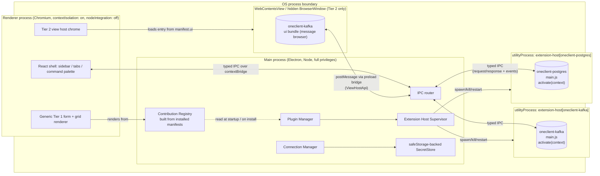
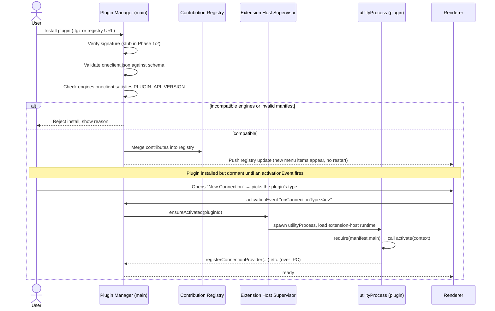
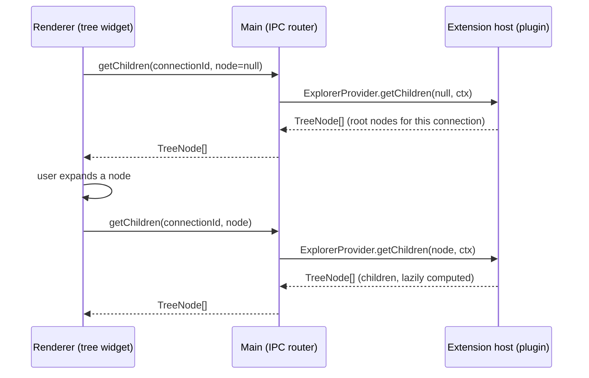

# oneClient Architecture (Phase 1)

This document covers the plugin system's architecture: process topology,
the contribution model, the plugin lifecycle, and the trust model. It's
written before any of `packages/core` exists — Phase 2 implements what's
described here.

## Goals

- The core ships with **zero** infrastructure-specific code. No `pg`,
  `kafkajs`, etc. anywhere under `packages/core`.
- New connection types / tree nodes / views / commands appear by **installing
  a plugin**, with no core rebuild and no app restart.
- A plugin that crashes, hangs, or leaks memory degrades only itself — the
  shell and other plugins keep working.
- Plugin authors have one dependency: `@oneclient/plugin-api`. Semver gates
  compatibility (`engines.oneclient` in the manifest vs `PLUGIN_API_VERSION`).

## Non-goals (for now)

- Running genuinely **untrusted/malicious** plugin code safely. See
  [Trust model](#trust-model--a-spec-risk-worth-flagging) below — this is a
  real gap in the spec as written, not something Phase 1 quietly solves.
- A plugin marketplace/registry backend. Phase 5 only needs install-from-URL
  and install-from-`.tgz`; a real registry service is out of scope here.

## Two runtimes, one backend

oneClient runs in two ways that share the same backend (`@oneclient/backend`) and UI (`@oneclient/workbench`):

| | Desktop (`@oneclient/core`) | Web (`@oneclient/server`) |
|---|---|---|
| Backend runs in | Electron's main process | a plain Node process |
| Plugin and terminal hosts | `utilityProcess` | `child_process.fork` (structured-clone IPC) |
| Shell ↔ backend | Electron IPC (preload) | one WebSocket per browser tab (token cookie, same-origin) |
| Tier 2 views | native `WebContentsView`s with the view preload | same-origin iframes; the server injects a script that gets `window.oneclientView` from the shell |
| Secrets | `safeStorage` (OS keychain / DPAPI), `secrets.json` | AES-256-GCM with `server.key`, `secrets-server.json` |
| Assets | `oneclient-asset://` protocol | `/asset/` HTTP route (same lookup: `resolve-asset.ts`) |
| Dialogs | native | in the page (folder browser on the server's disk; file download / upload) |

The backend only sees four interfaces:
- `Platform` — fork a helper process, encrypt a secret;
- `RpcHost` — handle calls, broadcast events;
- `ViewHost` — open, close and push to views;
- `FileDialogs`.

Each runtime implements them; `createBackend()` wires the rest. The shell's API object is built from one factory
(`createClientApi`) over either transport, so the two can't drift apart.

The web packages never depend on Electron: CI installs them alone and fails if Electron shows up.

The diagram below is the desktop runtime; in the web runtime, "Main process" is the Node server and the renderer is
a browser tab.

## Process topology



**One `utilityProcess` per *enabled* plugin**, not a shared host. This is
the direct consequence of "a crashing or hanging plugin must not freeze or
crash the UI": process-level isolation is the only isolation Node actually
gives you. A shared host would mean one plugin's infinite loop or native
crash takes every other plugin down with it. The cost is memory overhead
per plugin — acceptable here because infra-tool plugins are few (a handful
of DB/broker/IdP connections per user) and long-lived, not hundreds of
short-lived extensions like a general editor marketplace.

The renderer **never** talks to an extension host directly. Every call goes
renderer → main (over `contextBridge`) → main resolves which extension-host
process owns the target plugin → forwards over that process's IPC channel.
This keeps the renderer's attack surface and the plugin's attack surface
on two unrelated IPC links; a compromised renderer still can't reach plugin
code directly, and vice versa.

The wire protocol between main and an extension host (request/response
correlation, event fan-out, timeouts) is a **core-internal** concern —
plugin authors never see it. `@oneclient/plugin-api` only defines the
interfaces a plugin implements; the extension-host runtime (shipped as part
of core, loaded as the first module inside the `utilityProcess`) is what
calls `activate(context)` and marshals registry calls over that internal
protocol.

## Contribution model

The core never imports plugin code to decide what to render. At startup
(and on install/enable/disable), the Plugin Manager parses every installed
plugin's `oneclient.json` and merges `contributes` into one in-memory
**Contribution Registry**. The renderer queries that registry (via IPC) to
know which connection types to offer in "New Connection", which node types
can appear under which parent in the explorer tree, which views exist, and
which commands show in the palette / context menus.

Plugin *code* (the `ConnectionProvider`/`ExplorerProvider`/`CommandHandler`
implementations) is only activated lazily, driven by `activationEvents` in
the manifest — e.g. `onConnectionType:postgres` fires the first time a user
creates or opens a postgres connection. A plugin that's installed but never
used never spawns a process.

```mermaid
flowchart LR
    MF[oneclient.json] -->|parsed at install/startup| REG[Contribution Registry]
    REG -->|connectionTypes| NC["\"New Connection\" type list"]
    REG -->|explorerNodes| TREE[Sidebar tree shape]
    REG -->|views| VIEWS[Available views]
    REG -->|commands| PAL[Command palette / context menus]
    REG -.->|activationEvents match| ACT[Spawn extension host + activate]
```

## Plugin lifecycle



Disable/uninstall is the reverse: `SUP` sends a graceful-shutdown message
with a timeout, then `kill()`s the process if it doesn't exit — the
supervisor's crash-recovery path and its explicit-disable path are the same
code, which is what makes "hot-load without restart" safe for **code**
changes. It is deliberately *not* safe for the same process instance to
swap its own native dependencies at runtime — see
[Hot-reload vs. native modules](#hot-reload-vs-native-modules).

## Explorer tree expansion (runtime data flow)



Nothing is pre-fetched; every expand is a round trip. `TreeNode.data` is an
opaque payload the provider attaches to its own nodes and gets back
unchanged on the next call — core never interprets it.

## Tier 1 vs Tier 2 UI

**Tier 1 (default).** `ConnectionProvider.configSchema` (+ optional
`uiSchema`) drives a generic connection form; `CommandHandler.execute()`
results typed as `TableResult` drive a generic grid. Core owns all the
rendering, sorting, paging, CSV export, etc. Most plugins (`oneclient-postgres`,
most of `oneclient-kafka`) should need nothing beyond this tier.

**Tier 2 (custom views).** For UI Tier 1 can't express (Kafka's message
browser: live tailing, per-partition offsets, payload decoding). A manifest
view declares `tier: 2` and points `entry` at a small HTML/JS bundle under
`manifest.ui`. Two points worth flagging:

1. **Not an Electron `<webview>` tag.** The spec says "sandboxed webview,"
   but the `<webview>` tag is Electron's legacy, semi-deprecated embedding
   primitive — it's harder to lock down than a dedicated surface and
   Electron's own docs steer away from it. Tier 2 views are hosted in a
   dedicated `WebContentsView` (or hidden `BrowserWindow` if we need
   broader Electron-version support) with `nodeIntegration: false`,
   `contextIsolation: true`, a strict `Content-Security-Policy`, and a
   preload that injects only `ViewHostApi` (`postMessage`/`onMessage`/
   `invokeCommand`) — functionally what "sandboxed webview" is asking for,
   on a safer primitive.
2. **The plugin's view bundle is static HTML/JS/CSS, not a live dev server.**
   It's built at plugin-package time and shipped inside the `.tgz`, same as
   the `main` extension entry.

## Trust model — a spec risk worth flagging

Signature verification (stub now, real later) + `engines` compatibility
checks + per-plugin process isolation give you:

- **Provenance**: you know who published what you're installing (once
  verification is real).
- **Crash/resource containment**: one plugin's crash, infinite loop, or
  memory leak doesn't take down the shell or other plugins.
- **API-surface control**: a plugin can only reach the app through
  `@oneclient/plugin-api`'s registries — it can't `require("electron")`
  and start poking at other connections' secrets through core's own code.

They do **not** give you safety against a plugin that is *itself*
malicious. The extension host is a Node `utilityProcess` running as the
logged-in user with full OS privileges — same trust model as a VS Code
extension or an installed npm package. A plugin can still read the
filesystem, make arbitrary network calls, or exfiltrate whatever secrets
*it* legitimately receives at `connect()` time (how else would a Postgres
plugin get the password?). True sandboxing of arbitrary third-party Node
code with native addons (think `node-rdkafka`) isn't practical with
today's tooling (`vm2` is itself unsafe and unmaintained; worker threads
share the process's native-module/OS privileges).

**Recommendation:** be explicit in the Plugin Manager UI that installing a
plugin is a trust decision (like installing any desktop app extension), do
real signature verification against a known-publisher registry before
calling this "safe," and keep the per-plugin secret scoping described in
`SecretStore` so a plugin can't read *other* plugins' or *other
connections'* secrets even though it's trusted with its own.

## Hot-reload vs. native modules

"Hot-load without restart" is implemented as **killing and respawning the
plugin's `utilityProcess`**, not as hot-swapping modules inside a live
process. Node's `require` cache and any native addon (`.node` bindings,
FFI handles, open sockets) don't reliably tear down and reload in place —
attempting that is a known source of crashes and dangling-handle leaks,
especially for native database/broker drivers. Process-respawn is slower
than in-place module reload but is the only approach that's also safe for
native dependencies, and it reuses the exact same code path as
crash-recovery and explicit disable, so there's one lifecycle to test
instead of three.

## Native dependency concerns (flagged now, relevant from Phase 3 on)

| Plugin | Likely dependency | Native? | Notes |
|---|---|---|---|
| `oneclient-docker` | `dockerode` | No (talks to Docker Engine API over a Unix socket / Windows named pipe) | First reference plugin (Phase 3). No native deps, but `connect()` needs an OS-conditional transport path, and a clear error when the daemon isn't reachable. |
| `oneclient-postgres` | `pg` | No (pure JS protocol) | Safe to bundle as-is. |
| `oneclient-kafka` | `kafkajs` (default) vs `node-rdkafka` | `kafkajs`: no. `node-rdkafka`: yes (wraps librdkafka) | Default to `kafkajs` — Phase 5 README already calls this out. `node-rdkafka` needs prebuilt binaries per OS/arch/Node ABI (win32-x64, darwin-x64/arm64, linux-x64/arm64 at minimum) and complicates both plugin packaging and `electron-builder`/codesigning. |
| `oneclient-sqlserver` (future) | `mssql`/`tedious` | No | Pure JS (tedious). Safe. |
| `oneclient-mongodb` (future) | `mongodb` | No | Pure JS driver. Safe. |
| `oneclient-redis` (future) | `ioredis`/`redis` | No | Pure JS. Safe. |
| `oneclient-keycloak` (future) | plain REST (`fetch`) | No | No client lib needed. |

General rule for the Plugin Manager (Phase 5): if a plugin's `package.json`
pulls in a native addon, the installer should fetch/verify a prebuilt
binary matching the running Electron ABI + OS + arch, or refuse install
with a clear error — never trigger a `node-gyp` compile on a user's
machine.

## Repository layout

```
oneClient/
├── package.json                 pnpm workspace root
├── pnpm-workspace.yaml
├── tsconfig.base.json            shared strict TS config
├── ARCHITECTURE.md               this file
├── packages/
│   ├── plugin-api/               @oneclient/plugin-api — the only plugin-facing package
│   │   ├── src/                  ConnectionProvider, ExplorerProvider, CommandHandler,
│   │   │                         Tier 1/2 UI types, PluginManifest, PluginContext
│   │   ├── schema/
│   │   │   └── oneclient-manifest.schema.json
│   │   └── test/                 manifest-schema.test.ts + fixtures/
│   ├── backend/                  @oneclient/backend — the shared backend (plain Node, no Electron):
│   │                             createBackend(), plugins + extension host, connections, workspace,
│   │                             git, tasks, terminal host, search, themes, shared IPC contract
│   ├── workbench/                @oneclient/workbench — the UI (React + Vite) and core views; web bridge
│   ├── server/                   @oneclient/server — web runtime: HTTP + WebSocket server (no Electron)
│   ├── core/                     @oneclient/core — desktop runtime: Electron main, preloads, native views
│   ├── editor-kit/               the shared editor used by core views and plugin views
│   └── plugins/
│       ├── oneclient-docker/     Phase 3 reference plugin (Tier 1, + likely Tier 2 log view)
│       ├── oneclient-postgres/   Phase 4 reference plugin (Tier 1 only)
│       └── oneclient-kafka/      Phase 5 reference plugin (Tier 1 + Tier 2 message browser)
```

## Open questions carried into Phase 2

- Exact shape of the main↔extension-host internal IPC protocol (message
  envelope, timeouts, backpressure for streamed results like Kafka
  tailing). Internal-only, but needs to exist before any provider can be
  called.
- Whether `when` clause expressions (manifest `commands[].when`) get a tiny
  real expression evaluator or stay to a fixed set of core-recognized
  patterns for Phase 2 — leaning toward the latter to avoid building an
  expression language prematurely.
- Real signature verification scheme (who's the trust root — a registry's
  public key? per-publisher keys?) — stubbed through Phase 2, needed before
  Phase 5's Plugin Manager can honestly claim "verified."
