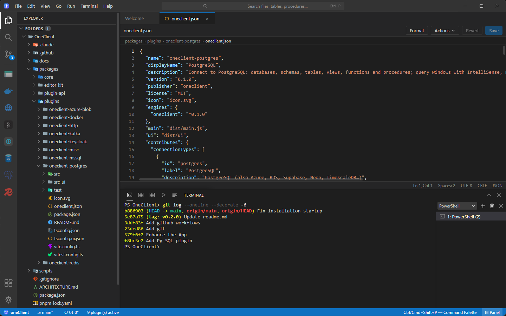
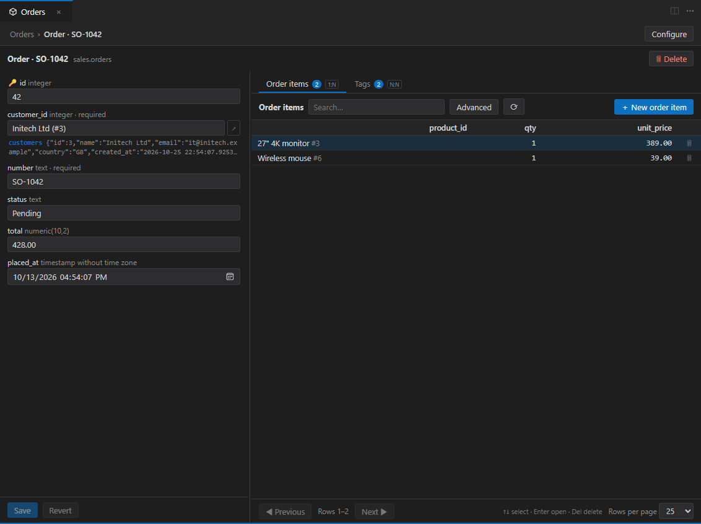
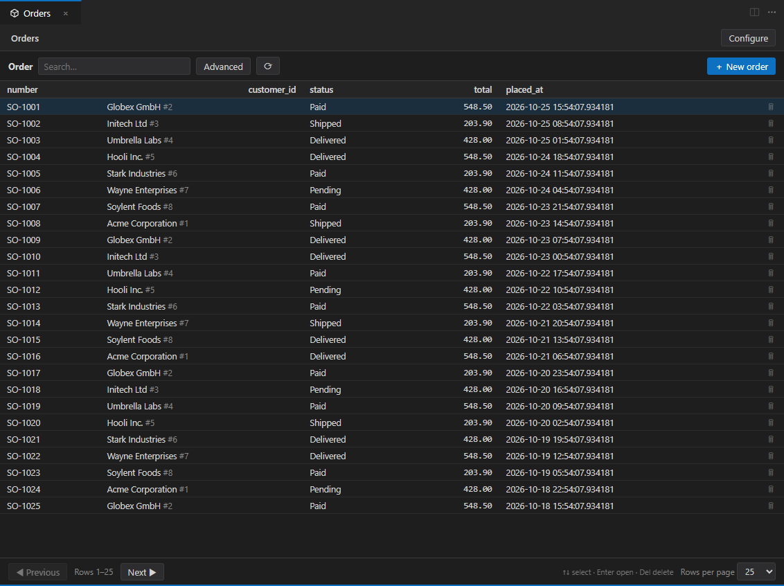
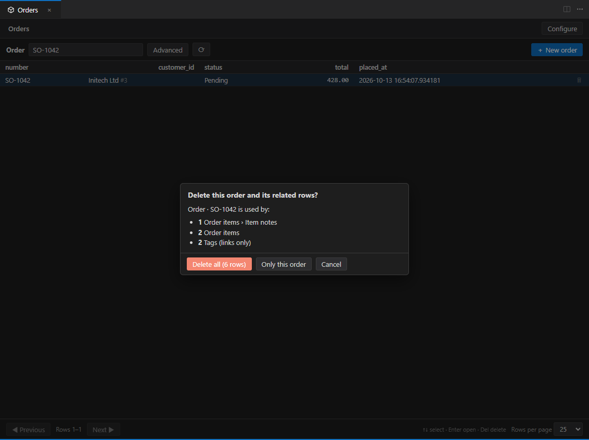
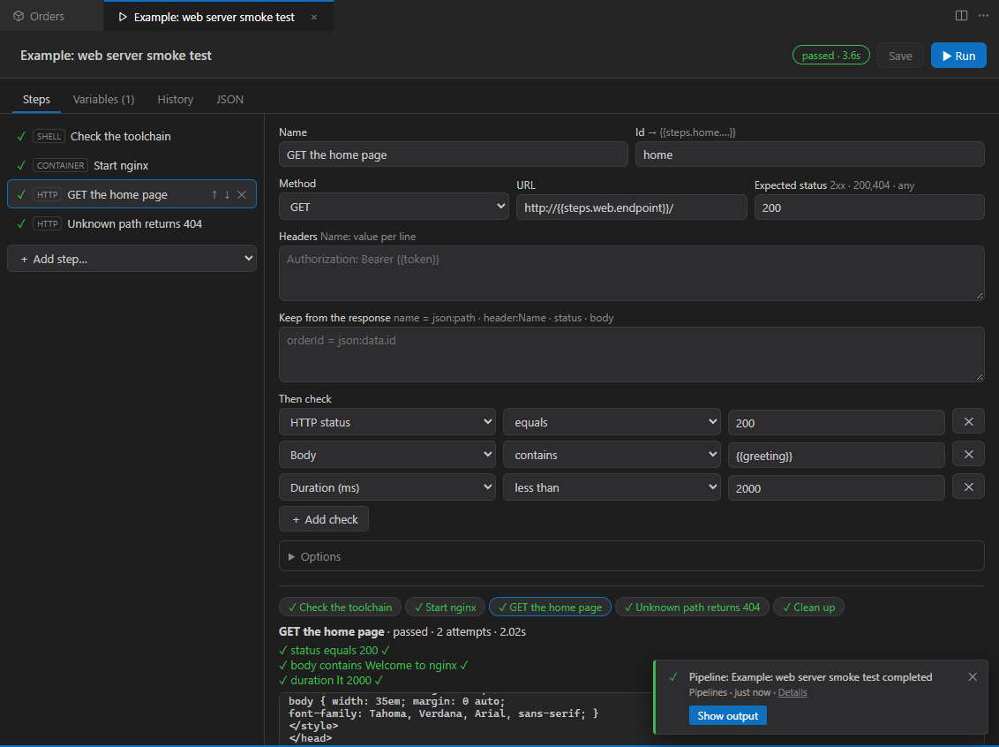
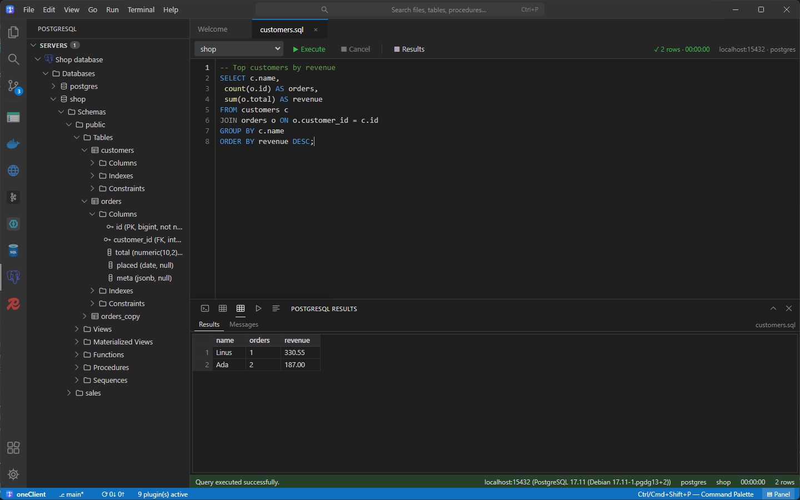
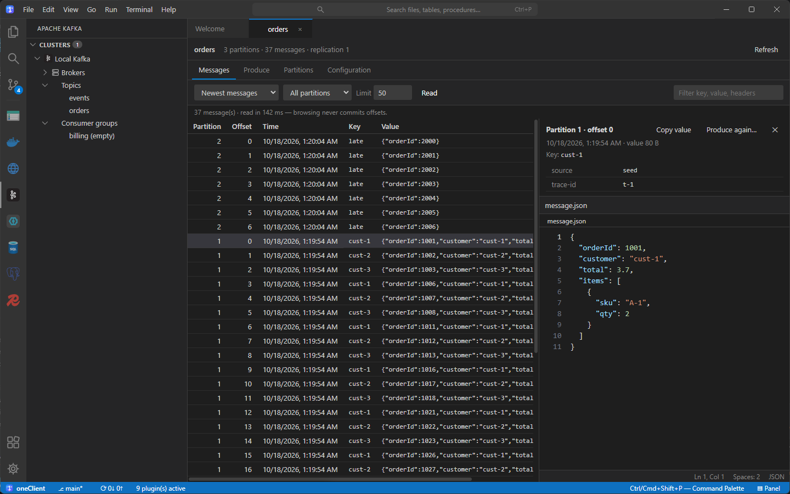
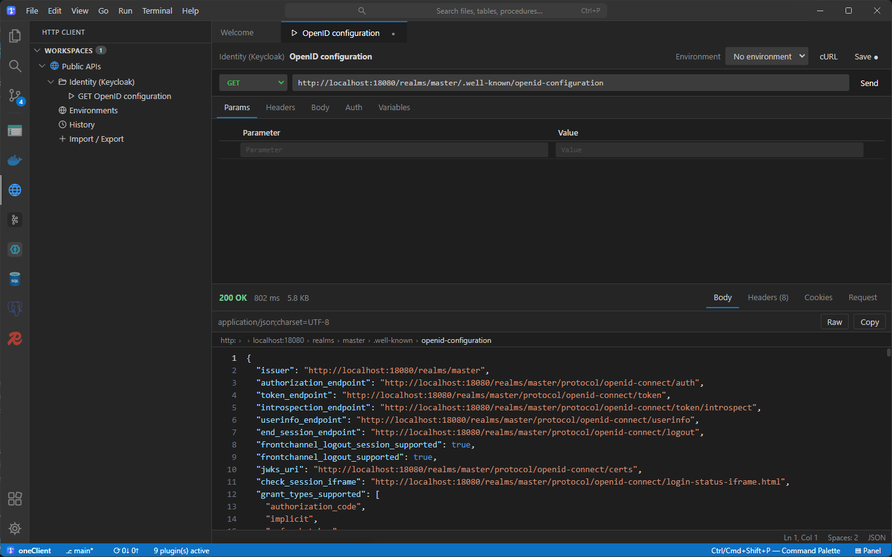
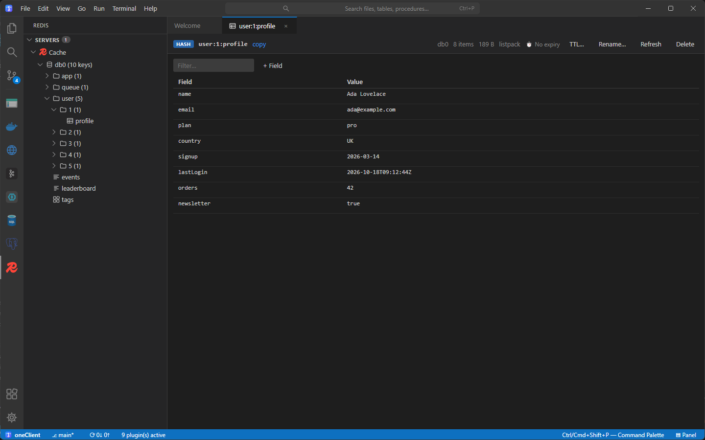

<div align="center">


# oneClient

### One client for your whole backend stack.

Query **PostgreSQL, SQL Server and MySQL**. Browse **Kafka and Redis**. Send **REST requests**. Spin up **test containers** and run
**scenarios** against them. All in one fast, **VS Code-style** window — free, open source and extensible.

[](https://github.com/AhmedKhalil777/OneClient/stargazers)
[](https://github.com/AhmedKhalil777/OneClient/releases)
[](./LICENSE)
[](https://github.com/AhmedKhalil777/OneClient/actions/workflows/ci.yml)

**[⬇ Download](https://github.com/AhmedKhalil777/OneClient/releases/latest)** &nbsp;·&nbsp;
**[🌐 Website](https://ahmedkhalil777.github.io/OneClient/)** &nbsp;·&nbsp;
**[📖 Guide](docs/GUIDE.md)** &nbsp;·&nbsp;
**[🧩 Plugin API](packages/plugin-api)** &nbsp;·&nbsp;
**[💬 Discussions](https://github.com/AhmedKhalil777/OneClient/discussions)**

<br />



<sub>Windows · macOS · Linux · self-hosted in the browser &nbsp;|&nbsp; No account · no telemetry · bring your own AI key</sub>

</div>

<br />

> **⭐ If oneClient saves you a tab or two, a star helps other developers find it.** It takes a second and it is the best way to support the project.

## Why oneClient?

Backend work means a database IDE, a Kafka tool, a Redis browser, an API client, Docker Desktop, a terminal and a Git UI — each
with its own login, its own shortcuts and its own window. oneClient puts them in **one workbench built like the editor you
already know**, and every integration is a **plugin** you can add, remove or write yourself.

|  |  |
| --- | --- |
| 🪟 **Stop switching windows** | Query a table, peek at the Kafka topic it feeds, replay the API call that wrote it and restart the container — in one place. |
| ⌨️ **Feels like VS Code** | Command palette, split editors, integrated terminal, Git graph, tasks, themes and the shortcuts already in your fingers. |
| 🧩 **Yours to extend** | A typed plugin API. Plugins run in their own process, load live, and can even offer tools to each other and to the AI assistant. |
| 🔒 **Yours to keep** | MIT licensed. No account, no telemetry. Passwords live in your OS keychain. The AI assistant uses *your* API key. |

## ✨ What's new

### Fast Aggregates — edit a whole Order, not four tables

Right-click a table. oneClient reads your foreign keys and builds the **aggregate**: a paged list of orders; each order opens into a
form with its items, payments and tags underneath — and every child opens the same way.



- **Navigate like a document** — Order › Items › Notes, with a breadcrumb back up.
- **One-to-many and many-to-many** — add, edit and delete children; link tags through the join table.
- **Parents by name** — pick the customer from a searchable list, or **create the missing one in a dialog** without losing your order.
- **Typed inputs** — date pickers, number fields, booleans and JSON, straight from the column types.
- **Safe by default** — delete previews what goes with a row, unsaved edits ask before you leave, database errors read like sentences.
- A plain `.aggregate.json` configuration you can commit. Works with **PostgreSQL, SQL Server and MySQL**.

<details>
<summary>More screenshots</summary>

| The list, with customers shown by name | Delete shows what goes with the row |
| --- | --- |
|  |  |

</details>

### Pipelines & test containers — turn a test scenario into a pipeline

Run a script, start a throwaway container, seed data, call your REST API and assert on the response — as ordered steps with
variables, retries and teardown, like a CI job you can run from your desk.



```text
shell      Check the toolchain
container  Start postgres:16 — wait until it accepts connections
shell      Seed data (PowerShell, pwsh, bash, sh or cmd)
http       POST /orders   →  assert status = 201, $.id exists
cleanup    Containers are removed — even if a step failed
```

A container's ports become variables (`{{steps.db.endpoint}}`); assert on status, JSON paths, headers, timing and exit codes; get live
output, run history and a **notification** when it finishes.

## Everything in the box

| | |
| --- | --- |
| **SQL** — PostgreSQL, SQL Server, MySQL / MariaDB | IntelliSense, multiple result sets, execution plans, query history, a staged table editor, CSV import, SSH tunnels |
| **Apache Kafka** | Topics, consumer groups, message browser with filters, producer (also Redpanda, Confluent Cloud, Event Hubs) |
| **Redis** | Namespace tree and editors for strings, hashes, lists, sets, sorted sets, streams and JSON, with TTL |
| **HTTP client** | Collections, environments, Postman and cURL import, `.http` files with a ▶ per request, chained requests |
| **Docker** | Containers, images, volumes, networks; one-click test databases and brokers with a ready connection |
| **Azure Blob Storage & Keycloak** | Browse and edit blobs, SAS links, Azurite; realms, users, roles, clients, token tools |
| **AI assistant** | Claude, OpenAI, Gemini, DeepSeek, Ollama and more — it reads schemas, runs read-only SQL and proposes edits **you approve** |
| **The workbench** | Source Control and Git graph, tasks, notifications, integrated terminal, multi-folder search, themes, command palette |

<table>
  <tr>
    <td width="50%"></td>
    <td width="50%"></td>
  </tr>
  <tr>
    <td width="50%"></td>
    <td width="50%"></td>
  </tr>
</table>

## 🚀 Get started

**Desktop** — download the installer for your system from the **[latest release](https://github.com/AhmedKhalil777/OneClient/releases/latest)**
(Windows `.exe`, macOS `.dmg`, Linux AppImage). Installers aren't code-signed yet, so Windows SmartScreen / macOS Gatekeeper ask you to
confirm the first launch; every release lists SHA-256 checksums.

**Browser (self-hosted)** — a small Node server serves the whole workbench, terminal and Git included:

```sh
docker build -t oneclient .
docker run -p 127.0.0.1:4180:4180 -v oneclient-data:/data oneclient
# open the link it prints: http://127.0.0.1:4180/?token=…
```

Keep it behind HTTPS if you expose it beyond localhost. More in the [guide](docs/GUIDE.md#run-it-in-a-browser-self-hosted-no-electron).

### Build from source

```sh
git clone https://github.com/AhmedKhalil777/OneClient.git
cd OneClient
pnpm install          # Node 22 LTS and pnpm 10
pnpm run build
pnpm --filter @oneclient/core run dev      # the desktop app, with hot reload
```

Linux needs `python3`, `make` and `g++` once, for the terminal's native module. Details and the web runtime are in the
[guide](docs/GUIDE.md#development).

## 🧩 Write a plugin

The core has no tool-specific code. A plugin declares what it contributes in `oneclient.json` and implements it with a small, typed API —
tasks, notifications, output channels, secrets, the workspace and other plugins' connections are one call away.

```ts
export function activate(context: PluginContext) {
  context.registerCommand({
    commandId: "hello.run",
    async execute() {
      await context.tasks.run({ title: "Say hello", cancellable: true }, async (task) => task.log("Hello from a plugin\n"));
      await context.notifications.success("Done", { actions: [{ label: "Show output", commandId: "hello.output" }] });
    },
  });
}
```

Read the **[plugin API](packages/plugin-api)** and **[ARCHITECTURE.md](ARCHITECTURE.md)**.

## How it compares

|  | oneClient | A stack of separate tools |
| --- | :---: | :---: |
| Databases, Kafka, Redis, REST, Docker in one window | ✅ | One app each |
| Same shortcuts, themes and command palette everywhere | ✅ | ❌ |
| Edit a table with its related tables as one screen | ✅ Fast Aggregates | Varies |
| Script → container → API → assert scenarios | ✅ Pipelines | Separate CI / scripts |
| Self-host in the browser | ✅ | Varies |
| Extend with your own integration | ✅ typed plugin API | Varies |
| AI with your own key, writes need your approval | ✅ | Varies |
| Price | Free, MIT | Mixed |

## 🗺 Ideas on the table

Code-signed installers · export / import of a whole aggregate as JSON and atomic "create / clone this order with its items" ·
a "name column" setting per table · more databases and brokers as plugins · a plugin gallery. Have another? [Start a discussion](https://github.com/AhmedKhalil777/OneClient/discussions).

## 🤝 Contributing

Plugins, bug reports, docs and small PRs are all welcome — see **[CONTRIBUTING.md](CONTRIBUTING.md)**. Looking for a place to start?
Try an issue labelled **[good first issue](https://github.com/AhmedKhalil777/OneClient/issues?q=is%3Aopen+label%3A%22good+first+issue%22)**.
Every plugin writes its activity and errors to the in-app **Output** panel — paste it into a bug report.

## ⭐ Star history

<a href="https://star-history.com/#AhmedKhalil777/OneClient&Date">
  
</a>

## License

[MIT](LICENSE) © oneClient contributors.

<div align="center"><sub>If oneClient is useful to you, <a href="https://github.com/AhmedKhalil777/OneClient">⭐ star it</a> and tell a teammate.</sub></div>
