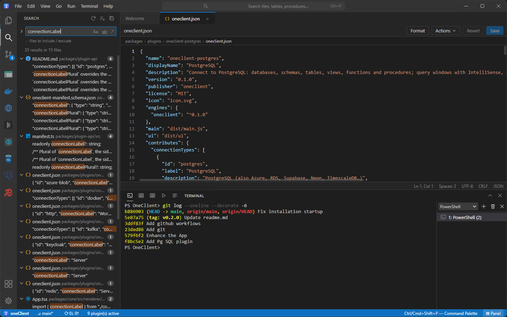
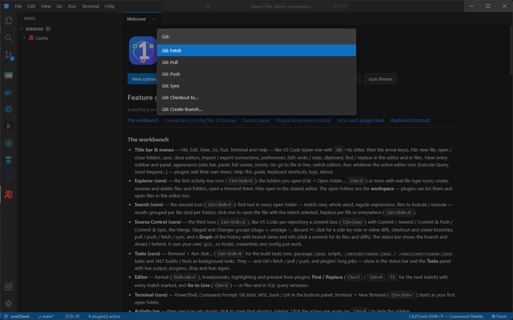
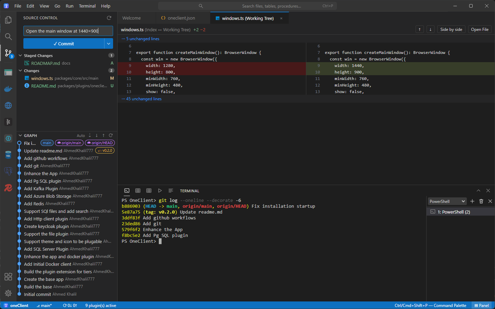
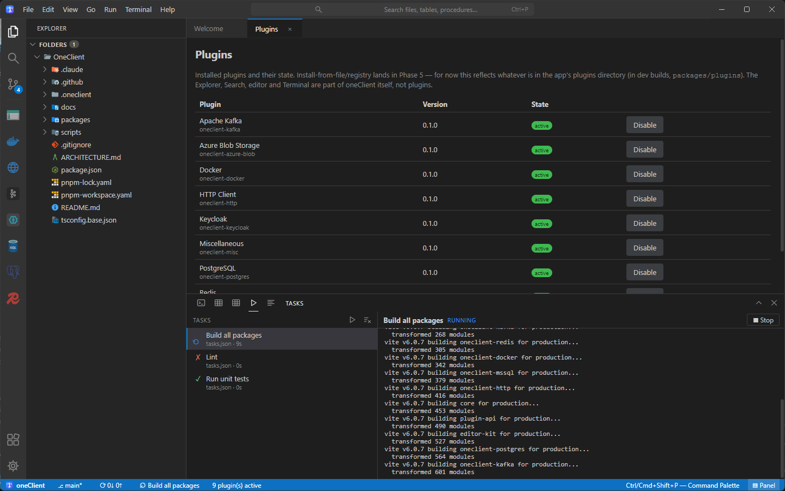
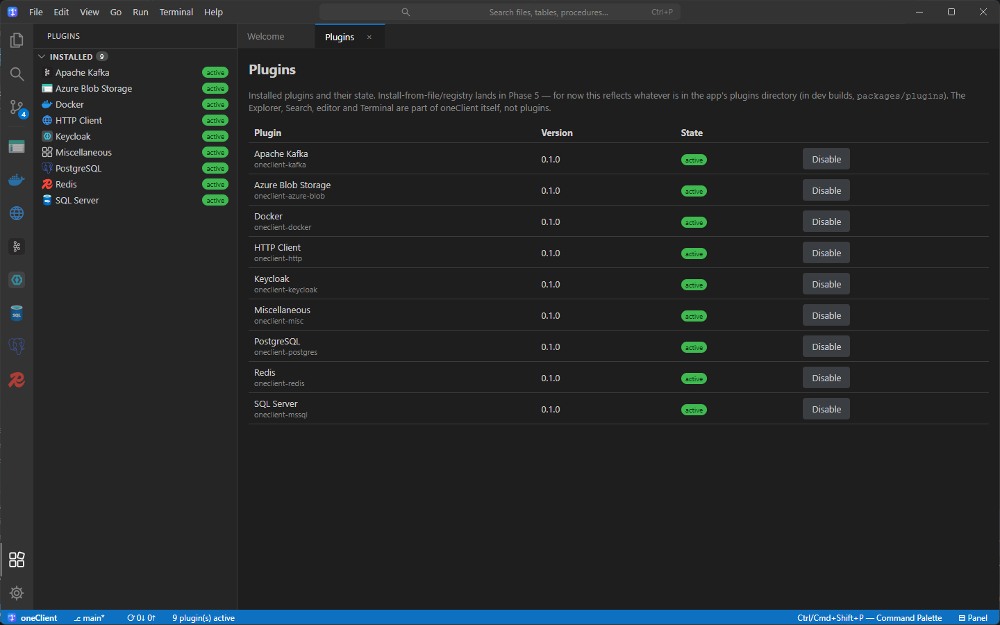

# oneClient

[](https://github.com/AhmedKhalil777/OneClient/actions/workflows/ci.yml)
[](https://github.com/AhmedKhalil777/OneClient/releases)

**One client for everything.** oneClient is a desktop console for the infrastructure you work with every day:
databases, message brokers, caches, REST APIs, containers and identity providers. It runs in one window and looks and
works like VS Code.

The core is a full workbench: Explorer, Search, editor, Git, Terminal and background tasks. Every integration is a
plugin. Plugins add connection types, explorer trees, editors and commands at runtime, with no rebuild or restart.


**[Download the latest release →](https://github.com/AhmedKhalil777/OneClient/releases/latest)** (Windows, macOS, Linux) ·
**[Website](https://ahmedkhalil777.github.io/OneClient/)**

## Features

### A real workbench

You get the Explorer, multi-folder workspaces, a shared editor (find / replace, go to line, format, breadcrumbs), an
integrated terminal (PowerShell, cmd, Git Bash, WSL, bash/zsh), title-bar menus and a command palette. Everything has
a keyboard shortcut you already know.

| Search across every open folder | Command palette |
| --- | --- |
|  |  |
| Match case, whole word, regex, include / exclude globs, and replace per file or everywhere. | Every core and plugin command, filtered as you type (`Ctrl+Shift+P`). |

### Source Control

The Source Control view works like VS Code's: staged and unstaged changes, a commit box with Commit / Amend / Push /
Sync, side-by-side or inline diffs, branch checkout and creation, and a commit **graph** with branch lanes and refs. It
uses your own `git`, so hooks, credentials and config just work.



### Background tasks

The task runner finds `package.json` scripts (npm / pnpm / yarn), `.vscode/tasks.json` / `.oneclient/tasks.json`
tasks and .NET builds. Tasks run in the background with live output, progress in the status bar, Stop and Run Again.
Git fetch / pull / push and long plugin jobs show up here too.



### Plugins for your infrastructure

| PostgreSQL & SQL Server | Apache Kafka |
| --- | --- |
|  |  |
| Browse databases, schemas, tables, views, functions and procedures. Query windows with IntelliSense, multiple result sets and messages. | Brokers, topics and consumer groups. Browse and filter messages, view partitions and configuration, produce messages. |

| HTTP client | Redis |
| --- | --- |
|  |  |
| Collections, folders, environments and history. Import from Postman or cURL. | Key tree grouped by namespace; editors for strings, hashes, lists, sets, sorted sets, streams and JSON; TTL, rename and delete. |

Docker, Azure Blob Storage and Keycloak are included too. Docker's **Templates** start any of these servers in a
container for local testing (PostgreSQL, SQL Server, Redis, Kafka, Azurite, Keycloak). Each one gets a ready connection
in its plugin, and every container shows which plugin and connection it belongs to. The Miscellaneous plugin adds
JSON / XML / SQL / Markdown editor support and Material file icons. The Plugins view shows what is installed. You can enable or disable
any plugin live.



## For developers

See [`ARCHITECTURE.md`](./ARCHITECTURE.md) for the process topology, contribution model, plugin lifecycle, and trust
model, and [`packages/plugin-api`](./packages/plugin-api) for the interfaces plugins implement.

### What's in the repo

oneClient runs in two ways that share one backend and one UI. The desktop app runs on **Electron**. The web
version is a self-hosted **plain Node** server that you use from a browser.

| Package | What | Electron? |
|---|---|---|
| `packages/backend` | The backend: plugin hosts, connections, workspace, Git, tasks, terminal, search, themes | no |
| `packages/workbench` | The UI (React + Vite): title bar menus, Explorer, Search, editor, Source Control, Terminal, Tasks, Output | no |
| `packages/server` | **Web runtime:** an HTTP + WebSocket server for the backend, serving the workbench to a browser | no |
| `packages/core` | **Desktop runtime:** the Electron shell (main process, preloads, native windows and views) | yes |
| `packages/plugins/*` | SQL Server, PostgreSQL, Redis, Kafka, Azure Blob Storage, Docker, Keycloak, HTTP client, Miscellaneous | no |
| `packages/plugin-api`, `packages/editor-kit` | What plugins depend on, and the shared editor | no |

Plugins run unchanged in both runtimes.

### Development

**You need:**

| Tool | Version | Notes |
|---|---|---|
| Node.js | **22 LTS** (minimum 20) | `.nvmrc` pins 22 (`nvm use`); CI and releases build on 22. |
| pnpm | **10** | `npm i -g pnpm@10` or `corepack enable`. Packaging uses `pnpm deploy --legacy`, which pnpm 9 doesn't have. |
| Git | any recent | For the Source Control view. |

On Windows and macOS you don't need Python or a C++ toolchain: the terminal's native module (`node-pty` 1.1) ships
prebuilt binaries for them. **On Linux** it has no prebuilt binary and compiles during `pnpm install`, so install
`python3`, `make` and `g++` first (Debian/Ubuntu: `sudo apt install build-essential python3`).

```sh
pnpm install
pnpm run build       # every package
pnpm run typecheck
pnpm run test
cd packages/core && pnpm run dev   # the app, with hot reload
```

### Run it in a browser (self-hosted, no Electron)

The web runtime installs and builds only the web packages, so Electron is never downloaded:

```sh
pnpm run web:install   # server, backend, workbench, plugins — no Electron
pnpm run web:build
pnpm run web:start     # prints:  Open: http://127.0.0.1:4180/?token=…
```

Open the printed link. The token in it is swapped for a cookie, so later visits only need `http://127.0.0.1:4180/`.
Run `node packages/server/dist/main.js --help` for every option. The main ones:

| Option / env | |
|---|---|
| `--port` / `PORT` | default 4180 |
| `--host` / `HOST` | default `127.0.0.1`, so only this machine can connect. Use `0.0.0.0` to serve your network, behind an HTTPS reverse proxy. |
| `--home` / `ONECLIENT_HOME` | config folder, default `~/.oneclient` |
| `--token` / `ONECLIENT_TOKEN` | access token; by default one is generated and kept in `<home>/server-token` |
| `--plugins` / `ONECLIENT_PLUGINS` | extra plugin folders. The bundled `packages/plugins` and `<home>/plugins` are always loaded. |
| `ONECLIENT_SECRET_KEY` | 32-byte key for saved passwords; by default one is generated in `<home>/server.key` |

**How the web version differs:**
- **Folders, Git and the terminal are on the server.** "Open Folder…" browses the server's disk, and the terminal opens
  a shell there.
- **Passwords are separate.** The server encrypts them with its own key, in `secrets-server.json`. The desktop app
  uses the OS keychain, so connections shared between the two need their passwords entered once in each.
- **One runtime per config folder.** The desktop app and the server refuse to run on the same config folder at the
  same time. Give each its own `ONECLIENT_HOME` to run both.
- **Some shortcuts belong to the browser,** such as Ctrl+W and Ctrl+N.

**Security:**
- Every request and the WebSocket need the token cookie (`HttpOnly`, `SameSite=Strict`).
- The WebSocket must come from the page's own origin.
- A server bound to localhost also rejects requests whose `Host` header is a foreign name (DNS rebinding).
- Whoever has the token has your connections and a terminal, so treat it like a password.

### Packaging & releases

```sh
pnpm run package       # installers for this OS → release/ (Windows: NSIS .exe + .zip, macOS: .dmg + .zip, Linux: AppImage + .tar.gz)
pnpm run package:dir   # just the unpacked app (quick check)
```

`scripts/package.mjs` builds everything, stages the app and each plugin with only their production dependencies
(`pnpm deploy`), and runs electron-builder; bundled plugins go to `resources/plugins`.

GitHub Actions:

- **CI** (`.github/workflows/ci.yml`) — every push to `main` and every pull request: install, build, typecheck and
  test on Windows; check that the app still packages; and check that the web runtime installs, builds and passes its
  tests with no Electron installed.
- **Release** (`.github/workflows/release.yml`) — push a version tag (`git tag v0.2.0 && git push origin v0.2.0`) or run
  it from the Actions tab with a version: tests, builds the installers on all three OSes, and publishes a GitHub
  Release with them, `SHA256SUMS.txt` and generated release notes. Tags with a `-` (`v0.2.0-beta.1`) become
  pre-releases; manual runs default to a draft. The installers aren't code-signed yet (Windows SmartScreen and macOS
  Gatekeeper will warn).

### Website

The landing page lives in [`site/`](site). `node scripts/build-site.mjs` assembles it into `_site/`, adding the
screenshots from `docs/images`, the app logo and the plugin icons. The **Website** workflow
(`.github/workflows/pages.yml`) publishes it to GitHub Pages whenever any of those change on `main`. Its download
buttons resolve to the latest release's files through the GitHub API.

### Screenshots

The images in [`docs/images`](docs/images) are real captures of the running app (1440×900, against local Docker
containers), taken with the `run-desktop` skill's driver: `size 1440x900` and then `ss-screen <name>`, which captures
the window as the OS shows it, plugin views included.
